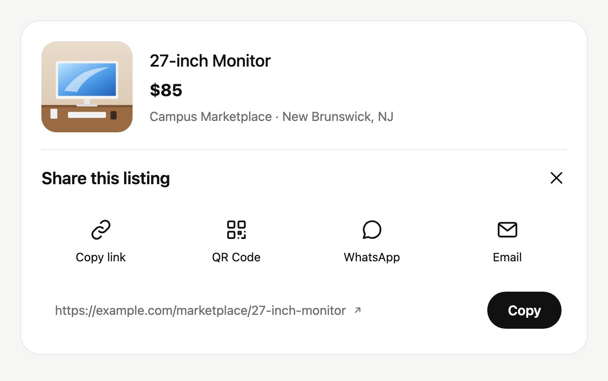

# share-widget

A small share panel for any website: **copy link, QR code (with PNG download), the phone's native share sheet, WhatsApp and email** — in one framework-free Web Component, with a thin React wrapper.



- Works on any site: plain HTML, React / Next.js, Vue, Svelte, server-rendered pages.
- Copy link always works: async Clipboard API with a fallback for older browsers, http pages and in-app browsers.
- "More" opens the native share sheet where the browser has one, and is hidden where it doesn't.
- **WeChat-aware:** inside WeChat's browser (which has no share API) "More" shows how to use WeChat's own ··· menu, and the QR panel says it can be scanned with WeChat.
- English and Chinese built in; every text can be overridden.
- Themeable with CSS variables, dark mode included; accessible (real buttons, focus handling, screen-reader announcements).
- Fires events for each share so you can count them in your own analytics. No tracking built in.
- One runtime dependency ([uqr](https://github.com/unjs/uqr), MIT) for QR encoding. ~12 KB gzipped as a single script.

## Try the demo

```bash
npm install
npm run build
npm run demo      # http://localhost:5173/demo/
```

The demo uses made-up listings and links only.

## Use it

### Script tag (any website)

```html
<script src="https://unpkg.com/share-panel-widget/dist/share-widget.global.js"></script>

<share-widget
  url="https://example.com/marketplace/27-inch-monitor"
  share-title="27-inch Monitor"
  share-text="$85 · pickup in New Brunswick"
  heading="Share this listing">
</share-widget>
```

Leave out `url` to share the current page.

### npm + bundler

```bash
npm install share-panel-widget
```

```js
import "share-panel-widget/define"; // registers <share-widget>
```

### React / Next.js

```tsx
import { ShareWidget } from "share-panel-widget/react";

<ShareWidget
  url="https://example.com/clubs/chess-club"
  shareTitle="Chess Club"
  shareText="Wednesdays 7pm, beginners welcome"
  heading="Share this club"
  mode="button"
  onShare={(e) => console.log(e.detail.method)}
/>;
```

`ShareWidget` is a client component and registers the element in the browser only, so it can be placed in a server component. Event props (`onCopy`, `onShare`, …) need a client component, as usual. See [`examples/next-app`](examples/next-app).

### Just the functions

The core helpers have no UI and no framework:

```js
import { copyText, nativeShare, qrSvg, qrPngBlob, composeShareText, shareTargetUrl } from "share-panel-widget";

await copyText(location.href);                          // true / false
await nativeShare({ url, title, text });                // "shared" | "cancelled" | "unsupported" | "failed"
const svg = qrSvg(url);                                  // SVG string
const png = await qrPngBlob(url, { scale: 12 });         // Blob
composeShareText({ url, title, text }, "{title}: {url}");
shareTargetUrl("whatsapp", { url, title, text });        // https://wa.me/?text=…
```

## Attributes

| Attribute | React prop | Default | What it does |
| --- | --- | --- | --- |
| `url` | `url` | current page | Link to share. Relative URLs are resolved; only http(s) links are accepted. |
| `share-title` | `shareTitle` | — | Title used in the share message, native sheet and email subject. |
| `share-text` | `shareText` | — | One-line description added to the share message. |
| `template` | `template` | `{title} — {text}` + newline + `{url}` | Custom share message. Empty lines are dropped. |
| `heading` | `heading` | "Share" | Panel heading, e.g. "Share this listing". |
| `actions` | `actions` | `copy,qr,whatsapp,native` | Buttons to show, in order. Also available: `email`. |
| `mode` | `mode` | `panel` | `panel` renders inline; `button` renders a Share button that opens the panel in a dialog (a bottom sheet on phones). |
| `lang` | `lang` | page language | `en` or `zh`. Falls back to the nearest `lang` attribute, then English. |
| `theme` | `theme` | `auto` | `light`, `dark` or `auto` (follows the system). |
| `utm` | `utm` | off | Adds `utm_source=<copy\|qr\|whatsapp\|email\|native>&utm_medium=share` to shared links. The visible link stays clean. |
| `closable` | `closable` | off | Shows a × in panel mode. Clicking it hides the widget unless `sw-close` is cancelled. |
| `image`, `preview-title`, `preview-subtitle`, `preview-meta` | `image`, `previewTitle`, … | — | Optional preview card above the panel (image, title, a bold line such as a price, a muted line). |

For a fully custom preview, put your own markup in the `preview` slot (in React: pass `children`):

```html
<share-widget url="…">
  <div slot="preview">…</div>
</share-widget>
```

### Text

Override any built-in text with the `labels` property:

```js
document.querySelector("share-widget").labels = { copyLink: "Copy store link", qr: "Scan" };
```

Keys: `share, heading, copyLink, qr, whatsapp, email, more, copy, copied, linkCopied, copyFailed, shareFailed, openLink, close, scanHint, download, qrAlt, wechatHint, gotIt, noUrl`.

### Methods

`el.open()` and `el.close()` open and close the dialog in button mode (`close()` hides the panel in panel mode).

## Styling

Set CSS variables on the element or any ancestor:

```css
share-widget {
  --sw-accent: #b45309;      /* Copy button background */
  --sw-on-accent: #fff;      /* Copy button text */
  --sw-radius: 14px;         /* card corner radius */
  --sw-font: Georgia, serif;
  --sw-bg: #fff;  --sw-fg: #111;  --sw-muted: #6b6b6b;  --sw-border: #e7e7e7;
  --sw-hover: rgba(0,0,0,.05);  --sw-focus: #2563eb;  --sw-success: #15803d;
}
```

For deeper changes, style the exposed parts: `share-widget::part(card)`, `heading`, `actions`, `action`, `action-copy`, `action-qr`, `action-whatsapp`, `action-email`, `action-native`, `qr`, `qr-code`, `download`, `url-row`, `url`, `copy-button`, `status`, `trigger`, `dialog`, `close`, `preview`, `preview-image`, `preview-title`, `preview-subtitle`, `preview-meta`, `divider`, `wechat-hint`.

To avoid a flash before the script loads, you can reserve space: `share-widget:not(:defined) { display: block; min-height: 180px; }`.

## Events

Every event bubbles out of the element with `detail.method` and `detail.url` (the link that was actually shared, including UTM tags):

| Event | When | Extra detail |
| --- | --- | --- |
| `sw-copy` | A copy button was clicked | `ok` — whether copying worked |
| `sw-share` | WhatsApp, email or native share | `result` for native: `shared`, `cancelled`, `failed`, `unsupported`; `method: "wechat-hint"` in WeChat |
| `sw-qr` | QR panel opened or closed | `open` |
| `sw-download` | QR PNG downloaded | `ok` |
| `sw-open` / `sw-close` | Dialog opened / closed (or panel closed with ×) | `sw-close` from × is cancelable |

```js
document.addEventListener("sw-share", (e) => analytics.track("share", e.detail));
```

## WeChat and link previews

- WeChat's built-in browser has no Web Share API and its share menu can't be opened from a page without WeChat's JS-SDK (which needs an official account and app ID). The widget therefore shows a hint pointing at the ··· menu. Copy link and QR code work as usual — the link pasted into a chat opens the page.
- The card that WeChat, WhatsApp, iMessage, Slack, etc. show for a pasted link comes from **the shared page's own meta tags**, not from this widget. Make sure each shareable page has:

  ```html
  <meta property="og:title" content="27-inch Monitor — $85">
  <meta property="og:description" content="Pickup in New Brunswick">
  <meta property="og:image" content="https://example.com/images/monitor-1200x630.jpg">
  <meta property="og:url" content="https://example.com/marketplace/27-inch-monitor">
  ```

## Browser support

Current Chrome, Edge, Firefox and Safari (15.4+, for `<dialog>`). The native share sheet is available on phones (iOS Safari, Android Chrome) and in some desktop browsers; where a browser has none, "More" is hidden and Copy link / QR code remain.

## 中文说明

一个可以放进任何网站的分享面板：复制链接、生成二维码并下载 PNG、调用手机系统分享、WhatsApp 和邮件。内置中英文（`lang="zh"`），在微信内置浏览器里点「更多」会提示用户用右上角 ··· 分享；二维码可以用微信扫。分享文案可以用 `template` 自定义（`{title}`、`{text}`、`{url}`），加上 `utm` 属性后每个渠道的链接会带上 `utm_source`，方便以后统计。

## Development

```bash
npm test          # unit tests (Node 22.18+ / 23.6+, runs the TypeScript sources directly)
npm run typecheck
npm run build     # dist/ (ESM + types) and dist/share-widget.global.js
npm run demo
```

## License

MIT © Bowen Zhang. Bundled QR encoder: [uqr](https://github.com/unjs/uqr) (MIT).
