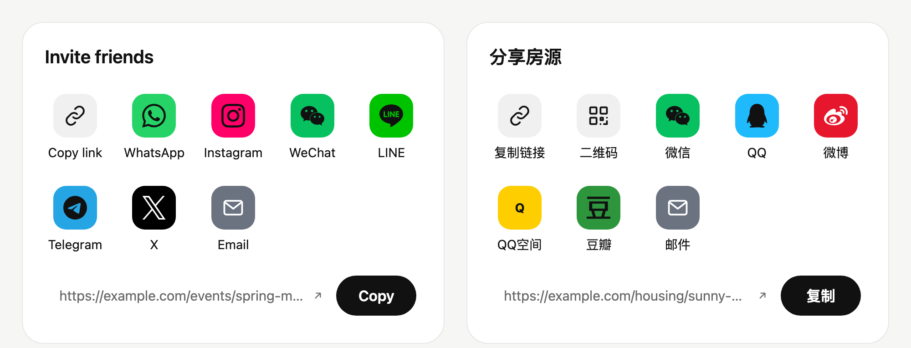

# sharehop

**Share to any app in one hop.** A small share panel for any website: **copy link, QR code (with PNG download), the phone's native share sheet, and 40+ apps** — WhatsApp, WeChat, Instagram, LINE, X, Weibo, Xiaohongshu, KakaoTalk, Telegram… — plus **a plug-in API to add your own**. One framework-free Web Component, with a thin React wrapper.


- Works on any site: plain HTML, React / Next.js, Vue, Svelte, server-rendered pages.
- **Jumps straight into apps.** Apps that accept a pre-filled share (WhatsApp, Telegram, X, Weibo…) open with the message ready. Apps that don't (WeChat, Instagram, Xiaohongshu, Douyin…) get the message copied and the app opened, so the user only has to paste. On a computer, WeChat and QQ show a QR code to scan instead.
- **Plug in your own app** with one call — a URL template is enough.
- Buttons that can't work on the current device hide themselves (no SMS on desktop, no webmail on phones), and in-app browsers that block app links get copy-and-paste instead.
- Copy link always works: async Clipboard API with fallbacks for older browsers, http pages and in-app browsers.
- **WeChat-aware:** inside WeChat's browser, "More" and the WeChat button point to WeChat's own ··· menu.
- English and Chinese built in; every text can be overridden. Brand-coloured app icons optional.
- Themeable with CSS variables, dark mode included; accessible (real buttons and links, focus handling, screen-reader announcements).
- Fires events for each share so you can count them in your own analytics. No tracking built in.

Every app link was checked against the service's own docs and requested live on 2026-11-18 — see [docs/TARGETS.md](https://github.com/timothyzhbw-jpg/sharehop/blob/main/docs/TARGETS.md) for each one's sources, confidence and caveats.

## Try the demo

```bash
npm install
npm run build
npm run demo      # http://localhost:5173/demo/
```

The demo uses made-up listings and links only.

## Use it

### Script tag (any website)

```html
<script src="https://cdn.jsdelivr.net/gh/timothyzhbw-jpg/sharehop@v0.2.0/dist/sharehop.global.js"></script>

<share-hop
  url="https://example.com/marketplace/27-inch-monitor"
  share-title="27-inch Monitor"
  share-text="$85 · pickup in New Brunswick"
  heading="Share this listing"
  actions="copy,qr,whatsapp,wechat,instagram,native">
</share-hop>
```

Leave out `url` to share the current page. The script is served by jsDelivr straight from the `v0.2.0` tag on GitHub. `sharehop.global.js` is ~35 KB gzipped with all brand logos; `sharehop.lite.global.js` (~19 KB) shows letter icons instead.

### npm + bundler

sharehop is not on the npm registry yet. Install it from GitHub — either the prebuilt release (no build step, works with npm, pnpm and yarn):

```bash
npm install https://github.com/timothyzhbw-jpg/sharehop/releases/download/v0.2.0/sharehop-0.2.0.tgz
```

or straight from the repository (npm builds it during install):

```bash
npm install github:timothyzhbw-jpg/sharehop#v0.2.0
```

Once it is published to npm, `npm install sharehop` will work too.

```js
import "sharehop/define"; // registers <share-hop>
```

### React / Next.js

```tsx
import { ShareHop } from "sharehop/react";

<ShareHop
  url="https://example.com/clubs/chess-club"
  shareTitle="Chess Club"
  shareText="Wednesdays 7pm, beginners welcome"
  heading="Share this club"
  mode="button"
  actions={["copy", "@messaging", "native"]}
  brandColors
  onShare={(e) => console.log(e.detail.method)}
/>;
```

`ShareHop` is a client component and registers the element in the browser only, so it can be placed in a server component. Event props (`onCopy`, `onShare`, …) and `targets` need a client component, as usual. See [`examples/next-app`](https://github.com/timothyzhbw-jpg/sharehop/tree/main/examples/next-app).

## Apps



List app ids in `actions`, in the order you want them, mixed freely with `copy`, `qr` and `native` (the "More" button):

```html
<share-hop actions="copy,whatsapp,wechat,instagram,x,native" brand-colors></share-hop>
```

| Kind | Apps (`id`) |
| --- | --- |
| Opens with the message filled in | `whatsapp`, `telegram`, `line`, `sms`, `email`, `snapchat`, `x`, `facebook`, `linkedin`, `reddit`, `threads`, `bluesky`, `pinterest`, `tumblr`, `mastodon`, `hackernews`, `vk`, `naver`, `band`, `hatena`, `nextdoor`, `flipboard`, `weibo`, `qzone`, `douban`, `googleclassroom`, `teams`, `gmail`, `outlook` |
| Copies the message, then opens the app | `wechat`, `qq`, `instagram`, `tiktok`, `discord`, `slack`, `kakaotalk`, `groupme`, `messenger`, `viber`, `xiaohongshu`, `douyin`, `zhihu`, `dingtalk` |

Aliases: `twitter` → `x`, `weixin` → `wechat`, `xhs` / `rednote` → `xiaohongshu` (shown as "rednote" in English), `mail` → `email`, `text` → `sms`.

Some only appear where they can work: `sms`, `messenger`, `viber`, `kakaotalk`, `groupme`, `xiaohongshu`, `douyin`, `zhihu` on phones; `gmail`, `outlook`, `teams` on computers; `pinterest` only when the widget has an `image`.

### Presets

`@name` in `actions` expands to a group of apps (and each still hides itself where it can't work):

| Preset | Apps |
| --- | --- |
| `@messaging` | sms, whatsapp, instagram, wechat, snapchat, kakaotalk, line, telegram, email |
| `@china` | wechat, qq, weibo, xiaohongshu, qzone, douyin, douban, email |
| `@social` | x, facebook, linkedin, reddit, threads, bluesky |
| `@school` | googleclassroom, teams, gmail, outlook, groupme, discord, slack |
| `@korea` | kakaotalk, band, naver, line |
| `@japan` | line, x, hatena |

```html
<share-hop lang="zh" actions="copy,qr,@china" brand-colors></share-hop>
```

Services blocked in mainland China (X, Facebook, WhatsApp, Telegram, LINE, Google) are left out of `@china`.

### How "copy, then open" behaves

1. Inside that app's own browser (e.g. the WeChat button inside WeChat): a hint points to the app's ··· menu.
2. On a computer, for phone-first apps (WeChat, QQ): the link is copied and the QR code opens, to scan with the phone.
3. Inside other in-app browsers (Instagram, TikTok, Android WebViews…), which block app links: the message is copied and the user is told to paste it in the app.
4. Otherwise the message is copied (synchronously, inside the tap, so it survives the app switch) and the app is opened — through its https universal link where it has one, or its URL scheme (an `intent://` URL on Android, which falls back to the Play Store). If nothing opens within ~1.6 s, the widget says so and reminds the user the link is copied.

## Plug in your own app

Register a share target once, then use its id in `actions` on any widget. Widgets already on the page update.

```js
import { registerShareTarget } from "sharehop"; // or window.ShareHop with the script tag

registerShareTarget({
  id: "campusforum",                       // lowercase letters, digits, dashes
  label: { en: "Campus Forum", zh: "校园论坛" },
  color: "#7c3aed",                         // used with brand-colors
  icon: '<svg viewBox="0 0 24 24">…</svg>', // optional; a letter icon is used otherwise
  href: "https://forum.example.edu/new?link={url}&title={title}&body={text}",
});
```

```html
<share-hop actions="copy,campusforum,x,native"></share-hop>
```

`href` placeholders are URL-encoded for you: `{url}`, `{title}`, `{text}`, `{message}` (title — text + newline + link), `{summary}` (the message without the link), `{image}`, `{host}`.

The full shape of a target (all optional except `id`, `label` and one way to act):

```ts
interface ShareTarget {
  id: string;
  label: string | { en: string; [lang: string]: string };
  icon?: string;                 // SVG markup, drawn with currentColor
  color?: string;                // brand colour for brand-colors
  href?: string | ((ctx: ShareContext) => string | null);   // template or function; null hides the button
  newTab?: boolean;              // default: true for http(s) links
  copy?: "link" | "message";     // copy this first…
  app?: string | { ios?: string; android?: string; desktop?: string; default?: string } | ((ctx) => string | null); // …then open this
  desktop?: "qr";                // on computers: copy and show the QR code instead
  insideApp?: (env) => boolean;  // page is inside this app's browser → point to its ··· menu
  platforms?: "mobile" | "desktop";
  available?: (env) => boolean;  // hide where it can't work
  onSelect?: (ctx, tools) => void | Promise<void>;  // fully custom click handling
}
```

`ctx` holds the share data (`url`, `title`, `text`, `message`, `summary`, `image`, `host`), the detected environment (`env.mobile`, `env.ios`, `env.android`, `env.wechat`, `env.inAppBrowser`) and the language. `tools` (for `onSelect`) offers `copy(text)`, `open(url, newTab?)`, `launchApp(scheme)`, `status(message)`, `openQr()` and `pointToMenu(message)`.

More examples:

```js
// A Mastodon instance of your own instead of the Share₂Fedi chooser:
registerShareTarget({ id: "mastodon", label: "Mastodon", href: "https://mastodon.social/share?text={message}" });

// Copy, then open an app by scheme (per platform):
registerShareTarget({
  id: "myapp",
  label: "MyApp",
  copy: "message",
  app: { ios: "myapp://", android: "intent://#Intent;scheme=myapp;package=com.example.myapp;end" },
  platforms: "mobile",
});

// Anything else:
registerShareTarget({
  id: "save",
  label: "Save for later",
  onSelect: async (ctx, tools) => {
    await fetch("/api/bookmarks", { method: "POST", body: JSON.stringify({ url: ctx.url }) });
    tools.status("Saved");
  },
});
```

- `registerShareTarget()` returns a function that removes exactly that registration again.
- Registering an existing id (e.g. `"telegram"`) overrides the built-in. That's also how you fix one if a service changes its link before this package updates.
- `unregisterShareTarget(id)` removes a target entirely; `listShareTargets()` and `getShareTarget(id)` read the registry.
- For one widget only, set `el.targets = [ … ]` (React: `targets={[…]}`); those win over registered targets with the same id. Setting the same targets again does nothing, so an inline array in React is fine.
- `icon` is inserted as markup: pass your own SVG, never text that came from users.
- Target links are never allowed to use `javascript:`, `data:` or similar schemes.

Without the widget, `shareTargetUrl("telegram", { url, title, text })` returns the share URL for any target.

## Attributes

| Attribute | React prop | Default | What it does |
| --- | --- | --- | --- |
| `url` | `url` | current page | Link to share. Relative URLs are resolved; only http(s) links are accepted. |
| `share-title` | `shareTitle` | — | Title used in the share message, native sheet and email subject. |
| `share-text` | `shareText` | — | One-line description added to the share message. |
| `template` | `template` | `{title} — {text}` + newline + `{url}` | Custom share message. Empty lines are dropped. |
| `heading` | `heading` | "Share" | Panel heading, e.g. "Share this listing". |
| `actions` | `actions` | `copy,qr,whatsapp,native` | Buttons to show, in order: `copy`, `qr`, `native` (or `more`), app ids and `@presets`. |
| `brand-colors` | `brandColors` | off | Show app icons as tiles in their brand colours. |
| `mode` | `mode` | `panel` | `panel` renders inline; `button` renders a Share button that opens the panel in a dialog (a bottom sheet on phones). |
| `lang` | `lang` | page language | `en` or `zh` for the widget's text (app names also have `ko`, `ja`, `ru` where they differ). Falls back to the nearest `lang` attribute, then English. |
| `theme` | `theme` | `auto` | `light`, `dark` or `auto` (follows the system). |
| `utm` | `utm` | off | Adds `utm_source=<channel>&utm_medium=share` to shared links (`copy`, `qr`, `native` or the app id). The visible link stays clean. |
| `closable` | `closable` | off | Shows a × in panel mode. Clicking it hides the widget unless `sh-close` is cancelled. |
| `image`, `preview-title`, `preview-subtitle`, `preview-meta` | `image`, `previewTitle`, … | — | Optional preview card above the panel (image, title, a bold line such as a price, a muted line). `image` (if it is an absolute http(s) URL) is also sent to Pinterest, Weibo, Qzone and others. |

For a fully custom preview, put your own markup in the `preview` slot (in React: pass `children`):

```html
<share-hop url="…">
  <div slot="preview">…</div>
</share-hop>
```

### Text

Override any built-in text with the `labels` property:

```js
document.querySelector("share-hop").labels = { copyLink: "Copy store link", qr: "Scan" };
```

Keys: `share, heading, copyLink, qr, more, copy, copied, linkCopied, copyFailed, shareFailed, openLink, close, scanHint, download, qrAlt, wechatHint, gotIt, noUrl, copiedOpening, opening, appNotOpened, appNotOpenedCopied, copiedPaste, copiedScan, scanWith, menuHint` (`{app}` in the last ones is replaced by the app's name).

### Methods

`el.open()` and `el.close()` open and close the dialog in button mode (`close()` hides the panel in panel mode).

## Styling

Set CSS variables on the element or any ancestor:

```css
share-hop {
  --sh-accent: #b45309;      /* Copy button background */
  --sh-on-accent: #fff;      /* Copy button text */
  --sh-radius: 14px;         /* card corner radius */
  --sh-font: Georgia, serif;
  --sh-bg: #fff;  --sh-fg: #111;  --sh-muted: #6b6b6b;  --sh-border: #e7e7e7;
  --sh-hover: rgba(0,0,0,.05);  --sh-focus: #2563eb;  --sh-success: #15803d;
  --sh-tile: rgba(0,0,0,.06); /* neutral icon tiles with brand-colors */
}
```

For deeper changes, style the exposed parts: `share-hop::part(card)`, `heading`, `actions`, `action`, `action-copy`, `action-qr`, `action-native`, `action-target`, `action-<app id>` (e.g. `action-wechat`), `qr`, `qr-code`, `download`, `url-row`, `url`, `copy-button`, `status`, `trigger`, `dialog`, `close`, `preview`, `preview-image`, `preview-title`, `preview-subtitle`, `preview-meta`, `divider`, `wechat-hint`.

Buttons are laid out in as many columns as fit (about 4 on a phone, more on a wide card); extra ones wrap onto further rows.

To avoid a flash before the script loads, you can reserve space: `share-hop:not(:defined) { display: block; min-height: 180px; }`.

## Events

Every event bubbles out of the element with `detail.method` and `detail.url` (the link that was actually shared, including UTM tags):

| Event | When | Extra detail |
| --- | --- | --- |
| `sh-copy` | A copy button was clicked | `ok` — whether copying worked |
| `sh-share` | An app or the native share was used | `method`: the app id, `native` or `wechat-hint`. `result` for native: `shared`, `cancelled`, `failed`, `unsupported`; for app launches: `opened`, `not-opened`, `unknown`, `blocked`, `copied`, `qr`, `menu-hint`. `ok` where known |
| `sh-qr` | QR panel opened or closed | `open` |
| `sh-download` | QR PNG downloaded | `ok` |
| `sh-open` / `sh-close` | Dialog opened / closed (or panel closed with ×) | `sh-close` from × is cancelable |

```js
document.addEventListener("sh-share", (e) => analytics.track("share", e.detail));
```

## WeChat and link previews

- WeChat's built-in browser has no Web Share API, and its share menu can't be opened from a page without WeChat's JS-SDK (which needs an official account and app ID). So inside WeChat the widget points to the ··· menu; elsewhere it copies the message and opens WeChat, or shows a QR code on computers.
- The card that WeChat, WhatsApp, iMessage, Facebook, LinkedIn, etc. show for a shared link comes from **the shared page's own meta tags**, not from this widget (Facebook and LinkedIn ignore any text you pass). Make sure each shareable page has:

  ```html
  <meta property="og:title" content="27-inch Monitor — $85">
  <meta property="og:description" content="Pickup in New Brunswick">
  <meta property="og:image" content="https://example.com/images/monitor-1200x630.jpg">
  <meta property="og:url" content="https://example.com/marketplace/27-inch-monitor">
  ```

## Browser support

Current Chrome, Edge, Firefox and Safari (15.4+, for `<dialog>`). The native share sheet is available on phones (iOS Safari, Android Chrome) and in some desktop browsers; where a browser has none, "More" is hidden and Copy link / QR code remain.

Opening apps can't be fully tested without the real devices and apps: detection that an app did *not* open is a best guess (the page didn't lose focus within ~1.6 s), and iOS Safari shows its own "Open in …?" prompt or an "address is invalid" alert for URL schemes.

## 中文说明

一个可以放进任何网站的分享面板：复制链接、二维码（可下载 PNG）、手机系统分享，以及 40 多个 App——微信、QQ、微博、小红书、抖音、QQ 空间、豆瓣、WhatsApp、Instagram、LINE、X、KakaoTalk……能预填内容的 App 会直接带着文案打开；微信、小红书、抖音、Instagram 这类不能预填的，会先复制文案再打开 App，用户粘贴即可；电脑上点微信或 QQ 会显示二维码让手机扫。在微信内置浏览器里会提示用右上角 ··· 分享。

目前还没上 npm，可以直接从 GitHub 安装：`npm install https://github.com/timothyzhbw-jpg/sharehop/releases/download/v0.2.0/sharehop-0.2.0.tgz`，或者在网页里用 `<script src="https://cdn.jsdelivr.net/gh/timothyzhbw-jpg/sharehop@v0.2.0/dist/sharehop.global.js"></script>`。

用 `actions="copy,qr,@china"` 一次加上中国常用 App；用 `registerShareTarget()` 可以接入任何别的 App（插口），一个 URL 模板就够了。内置中英文（`lang="zh"`），分享文案可以用 `template` 自定义，加上 `utm` 后每个渠道的链接会带上 `utm_source`，方便统计。

## Development

```bash
npm test               # unit tests (Node 22.18+ / 23.6+, runs the TypeScript sources directly)
npm run typecheck
npm run build          # dist/ (ESM + types) and the two single-file script builds
npm run demo
npm run check-targets  # request every built-in https share link (needs network)
npm run icons          # regenerate brand icons from simple-icons
```

## License

MIT © Bowen Zhang. Bundled QR encoder: [uqr](https://github.com/unjs/uqr) (MIT). Brand icons come from [simple-icons](https://simpleicons.org) (CC0-1.0); the brand names and logos are trademarks of their owners and are used only to link to their services.
